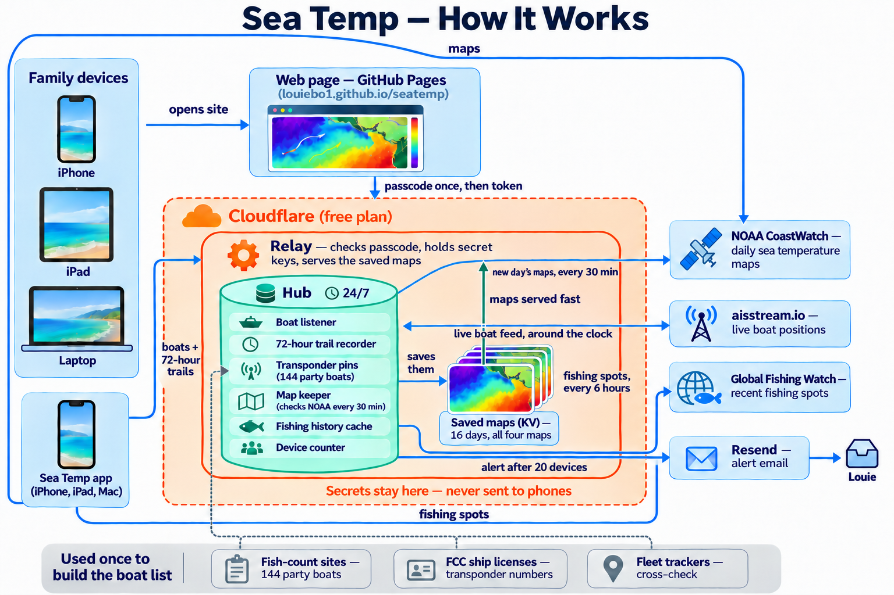

# Sea Temp — How It Works

First written 2026-10-23; updated 2026-11-19 for the round-the-clock boat recorder, trails,
transponder pins and the app reading boats through the relay. Louie makes the diagram in
ChatGPT from the description and prompt below. If the design changes, update the
description and prompt and ask Louie to remake the image — never generate it through an API.
(The picture above is still the October one until he remakes it.)

## Three layers, left to right

### 1. Users
- **Family devices** (iPhone, iPad, Mac, any browser) open the **web page** at
  `louiebo1.github.io/seatemp`.
- **The Sea Temp app** (`~/code/sst`) on Louie's iPhone, iPad and Mac. With the family
  passcode it gets **boats and trails from the relay**, like the web page. It still fetches
  the temperature maps from NOAA and the fishing history from Global Fishing Watch itself.
  (Without the passcode it can fall back to its own aisstream connection.)

### 2. Sea Temp's own parts
- **Web page (GitHub Pages)**
  - Plain HTML and JavaScript, with no keys or passwords in it.
  - Draws the temperature map, temperature lines, boats, **boat trails** and fishing spots.
  - Asks once for the family passcode, then remembers the device.
- **Relay (Cloudflare Worker, `seatemp.louiebo.workers.dev`)**
  - Checks the passcode and gives each device a sign-in token.
  - Holds the hidden secrets: passcode, aisstream key, Global Fishing Watch token, Resend key.
  - Fetches temperature maps from NOAA for the four maps (Monterey, Morro Bay, SoCal, Baja).
- **Hub (a Cloudflare Durable Object inside the relay)**, which runs **around the clock**:
  - **Boat listener:** a live connection to aisstream that never stops (it reconnects every
    minute if it drops), so it hears boats even when nobody is looking.
  - **Trail recorder:** every party boat's track for the last **72 hours**, a point a minute.
  - **Transponder pins:** which radio transponder (MMSI) belongs to which of the 144 party
    boats. 100 are known for sure; the hub learns the rest the first time it hears a boat
    with the name near its home harbor.
  - **Fishing history cache:** Global Fishing Watch results, refreshed every 6 hours.
  - **Device counter:** each device that unlocks; one email alert past 20.

### 3. Outside services
| Service | What it provides | Connection |
|---|---|---|
| NOAA CoastWatch (NASA JPL MUR) | Daily sea surface temperature maps, about 1 km | Relay → NOAA; app → NOAA |
| aisstream.io | Live boat positions from shore receivers (AIS) | Hub ↔ aisstream, 24/7 |
| Global Fishing Watch | Where vessels fished in the last 7–14 days | Hub → GFW; app → GFW |
| Resend | The alert email | Hub → Resend → Louie |

### Used once, to build the boat list (not live)
| Source | What it gave |
|---|---|
| Fish-count sites (SanDiego/SoCal/NorCalFishReports.com) | The 144 party boats and their landings |
| FCC ship radio licenses | Most of the 100 known transponder numbers |
| fishing-reports.ai fleet tracker, vessel databases | The rest, and a cross-check |

## Arrows
1. Family devices → Web page: "opens site"
2. Web page → Relay: "passcode once, then sign-in token"
3. App → Relay: "boats + 72-hour trails"
4. App → NOAA and → Global Fishing Watch: "maps", "fishing spots" (thin lines)
5. Relay → NOAA: "temperature maps"
6. Relay → Hub: "boats, trails, fishing history, device count"
7. Hub ↔ aisstream: "live boat feed, around the clock"
8. Hub → Global Fishing Watch: "fishing spots, every 6 h"
9. Hub → Resend → Louie: "alert after 20 devices"
10. Dotted grey arrows from the "used once" sources into the Hub's transponder pins: "boat list and transponder numbers (built in)"
11. A dashed line around Cloudflare: "Secrets stay here — never sent to phones"

## Layout
- **Left column:** family devices on top; the Sea Temp app (an iPhone with the app icon)
  below them.
- **Middle:** the web page box on top; a large Cloudflare box below it with the relay
  inside, and the hub inside the relay drawn as a cylinder split into five labeled parts.
  A small clock badge on the hub: "24/7".
- **Right column:** the four live services stacked (satellite, radio tower, globe with a
  fish, envelope).
- **Bottom strip, grey and dotted:** the three "used once" sources (a fish-count clipboard,
  an FCC license card, a map pin), with dotted arrows up to the hub's pins.

## Prompt for ChatGPT

> Create a clean, modern software architecture diagram on a white background, flat style, with labeled boxes and arrows. Title: "Sea Temp — How It Works". Match the style of the attached image (same colors, icons and fonts).
>
> Left column: at the top, icons of an iPhone, an iPad and a laptop labeled "Family devices". Below them, separated by a little space, an iPhone showing a sea-temperature app labeled "Sea Temp app (iPhone, iPad, Mac)".
>
> Middle: a box labeled "Web page — GitHub Pages (louiebo1.github.io/seatemp)" with a small ocean temperature map thumbnail (purple-blue-green-yellow-red) that has a few short pink and yellow boat trail lines on it. Below it, a large orange-outlined box labeled "Cloudflare (free plan)" containing a box "Relay — checks passcode, holds secret keys, fetches maps", and inside that a teal cylinder labeled "Hub" with a small clock badge reading "24/7", divided into five labeled bands: "Boat listener", "72-hour trail recorder", "Transponder pins (144 party boats)", "Fishing history cache", "Device counter". A dashed border around the Cloudflare box labeled "Secrets stay here — never sent to phones".
>
> Right column, stacked: "NOAA CoastWatch — daily sea temperature maps" (satellite icon), "aisstream.io — live boat positions" (radio tower icon), "Global Fishing Watch — recent fishing spots" (globe with fish icon), "Resend — alert email" (envelope icon) with a small inbox labeled "Louie" beside it.
>
> Arrows: Family devices → web page ("opens site"); web page → relay ("passcode once, then token"); Sea Temp app → relay ("boats + 72-hour trails"); thin arrows from the Sea Temp app → NOAA ("maps") and → Global Fishing Watch ("fishing spots"); relay → NOAA ("temperature maps"); hub ↔ aisstream ("live boat feed, around the clock"); hub → Global Fishing Watch ("fishing spots, every 6 hours"); hub → Resend → Louie ("alert after 20 devices").
>
> Along the bottom, in a light grey strip labeled "Used once to build the boat list", three small grey icons: a clipboard "Fish-count sites — 144 party boats", an ID card "FCC ship licenses — transponder numbers", a map pin "Fleet trackers — cross-check". Dotted grey arrows go from this strip up to the "Transponder pins" band of the hub.
>
> Use clear, readable sans-serif labels, soft blue and teal colors, orange for Cloudflare, and plenty of white space. No extra text beyond the labels.
